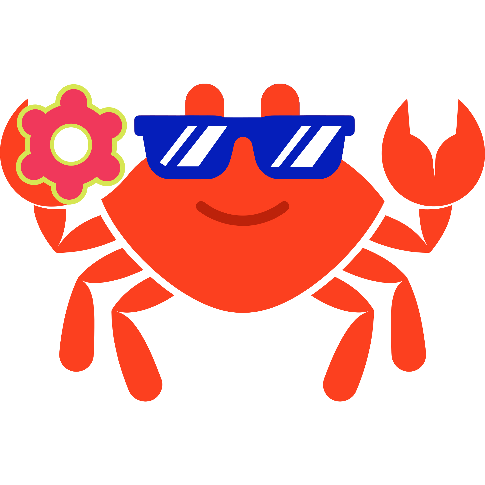

# Awesome Rust 

  

Rust is a language empowering everyone to build reliable and efficient software. This repository brings together useful projects, tools, and learning resources from across the Rust ecosystem.  
Whether you are building web applications, working with systems programming, exploring artificial intelligence, or developing embedded software, this list aims to help you find the right tools for your needs.
> Inspired by [awesome-python](https://github.com/vinta/awesome-python).
## Official Links
- [Rust Official Website](https://www.rust-lang.org/)
- [Rust Official Documentation](https://rust-lang.org/learn)
- [Rust Official Github](https://github.com/rust-lang)

## Contents

- [AI & Machine Learning](#ai--machine-learning)
  - [AI Agents](#ai-agents)
  - [Large Language Models](#large-language-models)
  - [Machine Learning](#machine-learning)
  - [Deep Learning](#deep-learning)
  - [Natural Language Processing](#natural-language-processing)
  - [Computer Vision](#computer-vision)

- [Web Development](#web-development)
  - [Web Frameworks](#web-frameworks)
  - [Web APIs](#web-apis)
  - [Web Servers](#web-servers)
  - [GraphQL](#graphql)
  - [WebSocket](#websocket)
  - [Authentication](#authentication)
  - [Template Engines](#template-engines)

- [Networking & Communication](#networking--communication)
  - [HTTP Clients](#http-clients)
  - [Networking](#networking)
  - [gRPC](#grpc)
  - [Messaging](#messaging)
  - [Email](#email)
  - [Web Scraping](#web-scraping)

- [Database & Storage](#database--storage)
  - [ORM](#orm)
  - [Database Drivers](#database-drivers)
  - [SQL Databases](#sql-databases)
  - [NoSQL Databases](#nosql-databases)
  - [Caching](#caching)
  - [Search](#search)
  - [Serialization](#serialization)

- [Data & Science](#data--science)
  - [Data Analysis](#data-analysis)
  - [Data Processing](#data-processing)
  - [ETL](#etl)
  - [Data Visualization](#data-visualization)
  - [Statistics](#statistics)
  - [Scientific Computing](#scientific-computing)
  - [Geospatial](#geospatial)

- [Developer Tools](#developer-tools)
  - [Testing](#testing)
  - [Debugging](#debugging)
  - [Code Analysis](#code-analysis)
  - [Documentation](#documentation)
  - [Profiling](#profiling)
  - [Algorithms](#algorithms)

- [DevOps & Cloud](#devops--cloud)
  - [Cloud](#cloud)
  - [Containers](#containers)
  - [CI/CD](#cicd)
  - [Distributed Systems](#distributed-systems)
  - [Observability](#observability)
  - [Logging](#logging)

- [CLI & GUI](#cli--gui)
  - [CLI Frameworks](#cli-frameworks)
  - [Terminal UI](#terminal-ui)
  - [GUI Frameworks](#gui-frameworks)
  - [Desktop Applications](#desktop-applications)

- [Media & Graphics](#media--graphics)
  - [Image Processing](#image-processing)
  - [Audio](#audio)
  - [Video](#video)
  - [Graphics](#graphics)
  - [Game Development](#game-development)
  - [Rendering](#rendering)

- [Rust Language](#rust-language)
  - [Async](#async)
  - [Concurrency](#concurrency)
  - [Macros](#macros)
  - [Memory Management](#memory-management)
  - [Functional Programming](#functional-programming)
  - [FFI](#ffi)
  - [Unsafe Rust](#unsafe-rust)

- [Rust Toolchain](#rust-toolchain)
  - [Cargo](#cargo)
  - [Compilers](#compilers)
  - [Package Management](#package-management)
  - [Linters](#linters)
  - [Formatters](#formatters)
  - [Build Tools](#build-tools)

- [Embedded & Hardware](#embedded--hardware)
  - [Embedded Systems](#embedded-systems)
  - [IoT](#iot)
  - [Robotics](#robotics)
  - [Microcontrollers](#microcontrollers)
  - [Hardware Interfaces](#hardware-interfaces)

- [Security](#security)
  - [Cryptography](#cryptography)
  - [TLS](#tls)
  - [Security Auditing](#security-auditing)
  - [Authentication](#authentication)
  - [Penetration Testing](#penetration-testing)

- [Operating Systems & Systems Programming](#operating-systems--systems-programming)
  - [Operating Systems](#operating-systems)
  - [Filesystems](#filesystems)
  - [Memory Management](#memory-management)
  - [Kernel Development](#kernel-development)
  - [Virtualization](#virtualization)

- [Resources](#resources)
  - [Books](#books)
  - [Courses](#courses)
  - [Tutorials](#tutorials)
  - [Conferences](#conferences)
  - [Communities](#communities)
  - [Podcasts](#podcasts)
  - [Newsletters](#newsletters)

- [AI Development Resources](#ai-development-resources)
  - [AI Coding Agents](#ai-coding-agents)
  - [AI Coding Instructions](#ai-coding-instructions)
  - [AI Agent Skills](#ai-agent-skills)
  - [AI Development Workflows](#ai-development-workflows)
  - [Model Context Protocol (MCP)](#model-context-protocol-mcp)
  - [AI Developer Tools](#ai-developer-tools)

- [Contributing](#contributing)
- [License](#license)

## AI & Machine Learning

Libraries and frameworks for building artificial intelligence and machine learning applications with Rust.

### AI Agents

- [Rig](https://github.com/0xPlaygrounds/rig)
  - A modular Rust framework for building LLM applications and AI agents with tool calling, multi-turn conversations, streaming, and memory management.
- [Swiftide](https://github.com/bosun-ai/swiftide)
  - A framework for building LLM agents with tool execution, typed task graphs, streaming workflows, and RAG pipelines.
- [AutoAgents](https://github.com/liquidos-ai/AutoAgents)
  - A modular multi-agent framework with type-safe agent execution, structured tool calling, configurable memory, and pluggable LLM backends.
- [LangChain Rust](https://github.com/Abraxas-365/langchain-rust)
  - A Rust implementation of LangChain that provides tool-using agents, memory, LLM chains, and integrations with multiple model providers.

### Large Language Models

- [mistral.rs](https://github.com/EricLBuehler/mistral.rs)
  - A fast and flexible Rust inference engine for running quantized large language models locally, with CPU, Apple Silicon, and CUDA support.
- [Candle](https://github.com/huggingface/candle)
  - A minimalist machine learning framework for Rust, with support for running transformer-based language models on CPU and GPU.

### Machine Learning

- [SmartCore](https://github.com/smartcorelib/smartcore)
  - A comprehensive machine learning library for Rust, featuring classification, regression, clustering, model evaluation, and numerical computing.
- [Burn](https://github.com/tracel-ai/burn)
  - A flexible and portable deep learning framework written in Rust, supporting neural networks, automatic differentiation, model training, and multiple hardware backends.
- [Linfa](https://github.com/rust-ml/linfa)
  - A Rust machine learning toolkit inspired by scikit-learn, providing classical algorithms, preprocessing, clustering, regression, and dimensionality reduction.

### Deep Learning

- [Neuronika](https://github.com/neuronika/neuronika)
  - A pure Rust deep learning library for building dynamic neural networks with reverse-mode automatic differentiation.
- [tch-rs](https://github.com/LaurentMazare/tch-rs)
  - Rust bindings for the PyTorch C++ API, providing tensor operations, automatic differentiation, neural network modules, and GPU acceleration.

### Natural Language Processing

- [Hugging Face Tokenizers](https://github.com/huggingface/tokenizers)
  - A fast and versatile tokenizer library written in Rust, supporting widely used subword tokenization algorithms and pretrained tokenizer models.
- [Lingua](https://github.com/pemistahl/lingua-rs)
  - A language detection library for Rust designed to identify languages accurately, including short text and individual words, with offline support.
- [Lindera](https://github.com/lindera/lindera)
  - A multilingual morphological analysis library for Rust, supporting tokenization, part-of-speech tagging, and text normalization for Japanese, Korean, and Chinese.

### Computer Vision

- [Kornia-rs](https://github.com/kornia/kornia-rs)
  - A low-level computer vision library in Rust for image processing, geometric transformations, camera pipelines, and 3D vision, with CPU and GPU support.
- [OpenCV Rust](https://github.com/twistedfall/opencv-rust)
  - Rust bindings for OpenCV, providing access to image processing, object detection, feature extraction, camera calibration, and computer vision algorithms.

**[⬆ Back to Top](#contents)**

## Web Development

Frameworks and libraries for building web applications, APIs, and web services.

### Web Frameworks

- [Actix Web](https://github.com/actix/actix-web)
  - A powerful and pragmatic web framework for building web applications.
- [Axum](https://github.com/tokio-rs/axum)
  - An ergonomic and modular web framework built around Tokio and Tower.
- [Rocket](https://github.com/rwf2/Rocket)
  - A web framework focused on usability, security, and developer experience.
- [Poem](https://github.com/poem-web/poem)
  - A full-featured and easy-to-use web framework with flexible routing, middleware, and OpenAPI support.
- [Salvo](https://github.com/salvo-rs/salvo)
  - A powerful and easy-to-use web framework with built-in support for HTTP/2, HTTP/3, OpenAPI, and middleware.
- [Loco](https://github.com/loco-rs/loco)
  - A Rails-inspired full-stack web framework for building web applications and APIs with built-in ORM, authentication, and background jobs.
- [Topcoat](https://github.com/tokio-rs/topcoat)
  - A modular, batteries-included full-stack Rust framework for server-rendered web applications with reactive client-side interactivity.

### Web APIs

- [Utoipa](https://github.com/juhaku/utoipa)
  - A code-first library for automatically generating OpenAPI documentation for Rust REST APIs, with integrations for Axum, Actix Web, and Rocket.
- [Poem OpenAPI](https://github.com/poem-web/poem/tree/master/poem-openapi)
  - A type-safe OpenAPI implementation for the Poem web framework, with support for automatic API documentation and interactive documentation interfaces.
- [Aide](https://github.com/tamasfe/aide)
  - A library for generating API documentation from Rust code, with a focus on integration with Axum and OpenAPI.

### Web Servers

- [Hyper](https://github.com/hyperium/hyper)
  - HTTP implementation for Rust, used to build HTTP clients and servers.
- [Pingora](https://github.com/cloudflare/pingora)
  - Framework for building HTTP proxies and other network services, developed by Cloudflare.
- [Static Web Server](https://github.com/static-web-server/static-web-server)
  - Serves static files over HTTP and HTTPS, with support for compression, caching, and access control.

### GraphQL

- [async-graphql](https://github.com/async-graphql/async-graphql)
  - GraphQL server library with async support, subscriptions, and integrations for Axum, Poem, and Actix Web.
- [Juniper](https://github.com/graphql-rust/juniper)
  - GraphQL server library that lets you define schemas using Rust types and connect them to existing web frameworks.
- [graphql-client](https://github.com/graphql-rust/graphql-client)
  - Generates type-safe Rust code for GraphQL queries and responses from your schema and query files.

### WebSocket

### Authentication

### Template Engines

**[⬆ Back to Top](#contents)**

## Networking & Communication

Libraries and tools for network communication, protocols, and distributed messaging.

### HTTP Clients

### Networking

### gRPC

### Messaging

### Email

### Web Scraping

**[⬆ Back to Top](#contents)**

## Database & Storage

Libraries and tools for database connectivity, data persistence, and storage management.

### ORM

### Database Drivers

### SQL Databases

### NoSQL Databases

### Caching

### Search

### Serialization

**[⬆ Back to Top](#contents)**

## Data & Science

Libraries for data processing, scientific computing, and analytical applications.

### Data Analysis

### Data Processing

### ETL

### Data Visualization

### Statistics

### Scientific Computing

### Geospatial

**[⬆ Back to Top](#contents)**

## Developer Tools

Tools and libraries that improve the software development workflow.

### Testing

### Debugging

### Code Analysis

### Documentation

### Profiling

### Algorithms

**[⬆ Back to Top](#contents)**

## DevOps & Cloud

Tools and libraries for infrastructure, deployment, cloud services, and operations.

### Cloud

### Containers

### CI/CD

### Distributed Systems

### Observability

### Logging

**[⬆ Back to Top](#contents)**

## CLI & GUI

Frameworks and libraries for building command-line, terminal-based, and graphical applications.

### CLI Frameworks

### Terminal UI

### GUI Frameworks

### Desktop Applications

**[⬆ Back to Top](#contents)**

## Media & Graphics

Libraries and tools for multimedia processing, graphics, rendering, and game development.

### Image Processing

### Audio

### Video

### Graphics

### Game Development

### Rendering

**[⬆ Back to Top](#contents)**

## Rust Language

Libraries and resources related to Rust language features and programming paradigms.

### Async

### Concurrency

### Macros

### Memory Management

### Functional Programming

### FFI

### Unsafe Rust

**[⬆ Back to Top](#contents)**

## Rust Toolchain

Tools for compiling, building, formatting, and managing Rust projects.

### Cargo

### Compilers

### Package Management

### Linters

### Formatters

### Build Tools

**[⬆ Back to Top](#contents)**

## Embedded & Hardware

Libraries and tools for embedded development and hardware interaction.

### Embedded Systems

### IoT

### Robotics

### Microcontrollers

### Hardware Interfaces

**[⬆ Back to Top](#contents)**

## Security

Libraries and tools for application security, cryptography, and secure development.

### Cryptography

### TLS

### Security Auditing

### Authentication

### Penetration Testing

**[⬆ Back to Top](#contents)**

## Operating Systems & Systems Programming

Libraries, tools, and projects for low-level programming and operating system development.

### Operating Systems

### Filesystems

### Memory Management

### Kernel Development

### Virtualization

**[⬆ Back to Top](#contents)**

## Resources

Learning materials and community resources for Rust developers.

### Books

### Courses

### Tutorials

### Conferences

### Communities

### Podcasts

### Newsletters

**[⬆ Back to Top](#contents)**

## AI Development Resources

Resources that help developers use AI tools and workflows when building Rust applications.

### AI Coding Agents

### AI Coding Instructions

### AI Agent Skills

### AI Development Workflows

### Model Context Protocol (MCP)

### AI Developer Tools

**[⬆ Back to Top](#contents)**

## Contributing

Contributions are welcome!

Please read the [Contributing Guidelines](CONTRIBUTING.md) before submitting a project or suggesting an improvement.

Make sure your submission is relevant to the Rust ecosystem, properly documented, and placed in the most appropriate category.

**[⬆ Back to Top](#contents)**

## License

This project is licensed under the [Creative Commons Attribution 4.0 International (CC BY 4.0)](https://creativecommons.org/licenses/by/4.0/).

**[⬆ Back to Top](#contents)**
